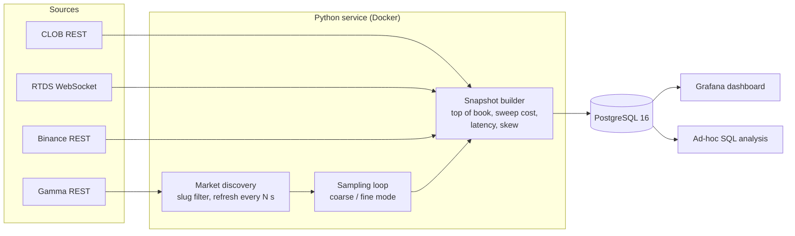

# Polymarket market telemetry — architecture overview

A Python service that collects synchronized market data for Polymarket short-term crypto "Up or Down" markets (BTC, ETH, SOL, XRP; 5m / 15m / 4h) together with the underlying asset prices, and stores it in PostgreSQL for analysis in Grafana and SQL.

> **This repository documents the design only.** The source code is kept private because it is part of a larger trading research project. Below: what the system does, how data flows, the data model and the engineering decisions.

## Problem

Short-term prediction markets resolve against a reference price (Chainlink). To study how the market price follows the underlying asset, every observation has to combine several sources that update at different speeds, and record **when** each value was produced and how old it was at sampling time.

## Data sources

| Source | Protocol | Data |
|---|---|---|
| Polymarket Gamma API | REST | market discovery, market metadata by slug, final price of closed markets |
| Polymarket CLOB API | REST | order books (bid/ask levels) per outcome token |
| Polymarket RTDS | WebSocket | Chainlink reference prices (btc/usd, eth/usd, …) |
| Binance Spot / Futures | REST | spot price, mark price, klines (5m … 1d) |

## Architecture

## Data model

| Table | Grain | Key columns |
|---|---|---|
| `market_time_observations` | one row per market × outcome × sample | best bid / ask / mid, top-of-book sizes, cost to sweep 10 / 25 shares, reference price (Chainlink), Binance spot and mark, source timestamps, request latency, sampling skew, seconds to close |
| `underlying_candles` | symbol × resolution × candle open time | OHLCV, trades count, taker volumes, source timestamp, latency |
| `orderbook_observations` | market × sample | order book levels captured for near-miss analysis |
| `signal_episodes` | one row per detected episode | start / hit / end time, duration, max value, executable size, JSON metadata |

Design choices in the schema:

- **Natural primary keys** (e.g. market, token, outcome, observed_at) make writes idempotent on retries.
- **CHECK constraints** reject impossible values at write time (bid > ask, negative latency, high < low).
- **Explicit NULLs** instead of fallbacks: when a source has no value, the column stays NULL rather than being filled from another source, so dashboards never mix sources silently.
- **Indexes** on observation time, time buckets and market keys for time-range dashboard queries.

## Sampling and data quality

- Two sampling modes: a configurable coarse interval (around 1 s) and a finer interval in a short window around each 5-minute close, when prices move the most.
- Markets for the current and previous window are pre-fetched before the close boundary, so API calls do not create a gap at the moment that matters.
- Every snapshot stores the source timestamp and request latency per source, plus the skew between sources. Snapshots exceeding skew or age thresholds can be filtered out in analysis.
- Closed markets are re-read periodically to store the final resolution price.

## Consumption

Grafana dashboard on PostgreSQL:

- reference price vs Binance per asset and timeframe;
- data age and sync skew per source (ms);
- correlation by lag and best lag between Binance and the reference price;
- spread and spread z-score between the two prices;
- observations per minute (pipeline health).

## Operations

- Docker Compose: PostgreSQL 16, Grafana and the service; ports bound to `127.0.0.1`, remote access through an SSH tunnel.
- Configuration through environment variables (`.env`), typed with pydantic-settings; no secrets in the repository.
- Schema changes as versioned SQL migration scripts.
- Unit tests for parsing logic with recorded API fixtures.

## Stack

Python · SQLAlchemy · PostgreSQL 16 · WebSockets · REST · pydantic-settings · Docker Compose · Grafana

## Limitations

- Sampling uses REST polling for order books and Binance prices, so time resolution is bounded by request latency and rate limits.
- Single process; no message queue between ingestion and storage.
- Migrations are applied manually (no migration tool).
